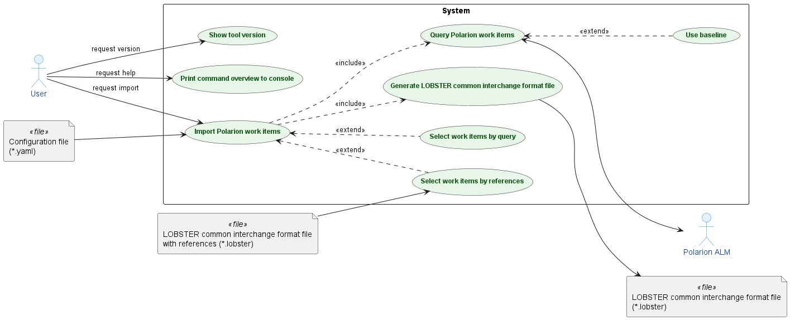
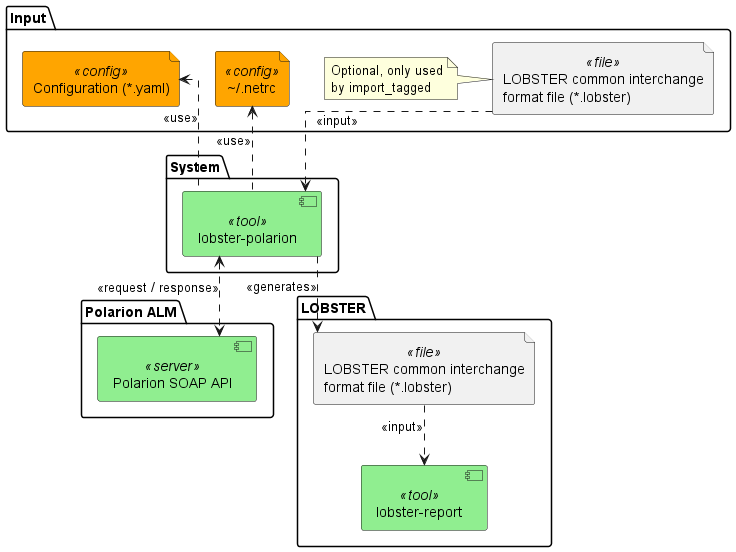

# Software Architecture

The following section describes the high level software architecture.
For an overview of the complete LOBSTER toolchain see the Overview section in [main README](../README.md).

The lobster-polarion tool reads work items (e.g. requirements) from Polarion ALM and writes them in the
LOBSTER common interchange format. This allows to use Polarion work items in a LOBSTER tracing report.

## Use Cases

The main use case is the import of Polarion work items. It always queries the work items from Polarion and generates
the LOBSTER common interchange format file. Which work items are imported depends on the import mode in the
configuration file:

- Select work items by query (`import_query`): The work items are selected by a Polarion query.
- Select work items by references (`import_tagged`): The work items are selected by the `req` references of an
  existing LOBSTER common interchange format file, e.g. the output of lobster-python.

Optionally the work items are queried from a Polarion baseline instead of the current state (use baseline).

## Context Diagram

The following picture shows the overall tool flow:

| Interface                                                | Direction | Description                                                                         |
| -------------------------------------------------------- | --------- | ----------------------------------------------------------------------------------- |
| Configuration (*.yaml)                                   | In        | Polarion server, project, import mode and mapping to the LOBSTER items.             |
| `~/.netrc`                                               | In        | Fallback for the credentials, if they are not given in the configuration.           |
| LOBSTER common interchange format file (*.lobster)       | In        | Optional, only used by `import_tagged`. Contains the `req` references.              |
| Polarion SOAP API                                        | In / Out  | Request of the work items and response with their fields and links.                 |
| LOBSTER common interchange format file (*.lobster)       | Out       | Generated file with the Polarion work items. Input for lobster-report.              |
