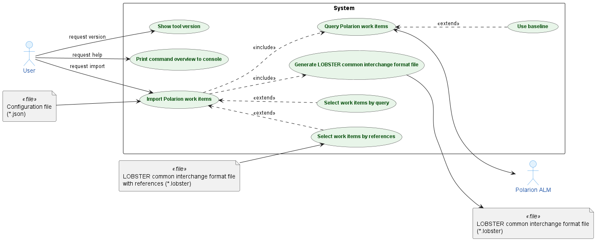
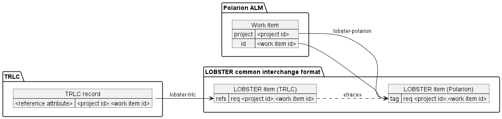
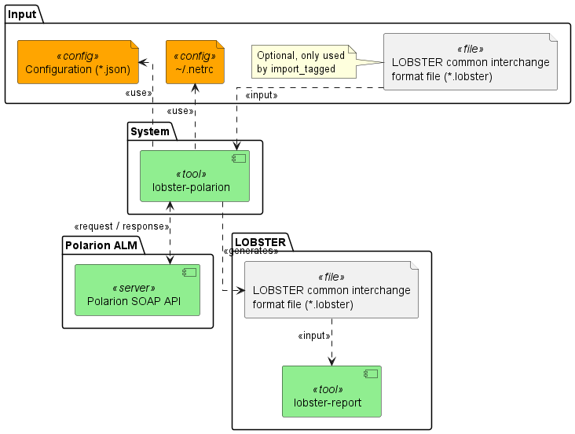

# Software Architecture

The following section describes the high level software architecture.
For an overview of the complete LOBSTER toolchain see the Overview section in [main README](../README.md).

The lobster-polarion tool reads work items (e.g. requirements) from Polarion ALM and writes them in the
LOBSTER common interchange format. This allows to use Polarion work items in a LOBSTER tracing report.

## Use Cases

The main use case is the import of Polarion work items. It always queries the work items from Polarion and generates
the LOBSTER common interchange format file. The work items are selected by a Polarion query (`import_query`) in the
configuration file. This imports also work items which are not referenced yet, so the tracing report shows the
missing coverage.

In contrast to lobster-codebeamer there is no selection by references (`import_tagged`), because it imports only
the referenced work items and therefore can't show missing coverage.

Optionally the work items are queried from a Polarion baseline instead of the current state (use baseline).

## Preconditions

Polarion is the source of the higher level work items (e.g. stakeholder requirements). The lower level items
(e.g. TRLC records or source code) reference them, lobster-polarion has no knowledge about TRLC.

- A TRLC record holds the referenced Polarion work items in a reference attribute. The attribute is defined by the
  user in the TRLC model with any name and is configured as `tags` field in the lobster-trlc configuration, which
  maps its values to `req` references.
- Polarion work item ids are only unique within a Polarion project. Therefore a reference contains the Polarion
  project id and the work item id in the format `<project id>:<work item id>`.
- lobster-polarion generates the tag of each work item in the same format, so lobster-report can resolve the
  references.

## Context Diagram

The following picture shows the execution context of the tool:

| Interface                                          | Direction | Description                                                                                              |
| -------------------------------------------------- | --------- | -------------------------------------------------------------------------------------------------------- |
| Configuration (*.json)                             | In        | Polarion server, credentials (user and password), project, import mode and mapping to the LOBSTER items. |
| Polarion SOAP API                                  | In / Out  | Request of the work items and response with their fields and links.                                      |
| LOBSTER common interchange format file (*.lobster) | Out       | Generated file with the Polarion work items. Input for lobster-report.                                   |
